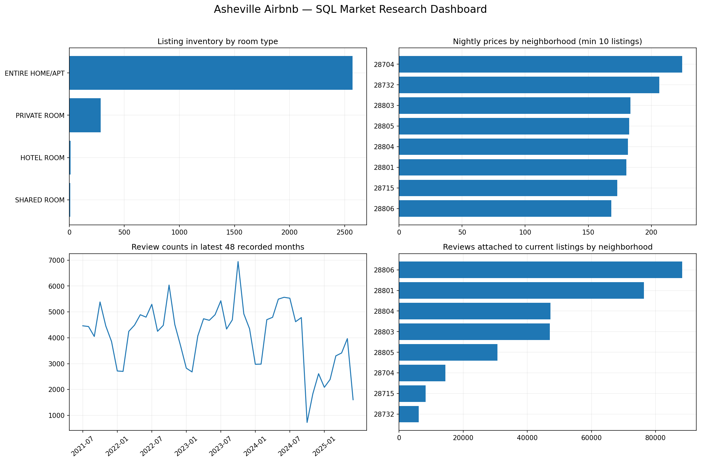

# Asheville Airbnb Market Opportunity — SQL Analytics

## Business question
Evaluate price positioning, neighborhood supply, host concentration and historic review activity to assess the potential for travel-service expansion in Asheville, North Carolina.

## Source and scope
Inside Airbnb: `listings.csv` (snapshot inventory), `reviews.csv` (historical reviews) and `neighbourhoods.csv` (optional reference table). Current listing inventory is not the same as the population of every historical listing. The three source CSVs (`listings.csv`, `reviews.csv`, and `neighbourhoods.csv`) are included in this GitHub repository. They can also be obtained from the original Inside Airbnb extract; ensure the source dates match before reproducing results.

## Core findings
- **Unique listing snapshot:** 2,876 listings.
- **Mean advertised nightly price:** $181.26; **median:** $128.00 (valid advertised prices >0 and <=$10,000). Fees/taxes not included.
- **Largest room type:** ENTIRE HOME/APT.
- **Linked historical review rows:** 318,549 (reviews matched to the current listing IDs). Neighborhood **28806** has the most linked review activity, with **88,316** reviews.
- **Highest recorded yearly review count:** 2023; **highest recorded calendar month:** 2023-10. Boundary periods may be partial and review volume is not booked nights.

## Room type distribution
| room_type | listing_count | pct_listings | avg_nightly_price |
| --- | --- | --- | --- |
| ENTIRE HOME/APT | 2571 | 89.39 | 190.13 |
| PRIVATE ROOM | 285 | 9.91 | 94.31 |
| HOTEL ROOM | 12 | 0.42 | 230.42 |
| SHARED ROOM | 8 | 0.28 | 37.25 |

## Neighborhood listing supply and pricing
| neighbourhood | listing_count | avg_nightly_price | linked_review_rows |
| --- | --- | --- | --- |
| 28806 | 807 | 168.37 | 88316 |
| 28801 | 594 | 180.16 | 76405 |
| 28803 | 455 | 183.38 | 47021 |
| 28804 | 379 | 181.31 | 47229 |
| 28805 | 282 | 182.39 | 30685 |
| 28704 | 191 | 224.44 | 14428 |
| 28715 | 93 | 172.96 | 8282 |
| 28732 | 75 | 206.34 | 6183 |

## Top 5 most expensive neighborhoods
Requires at least 10 listings with valid advertised nightly prices. Rankings are descriptive and do not adjust for property size or room type.
| neighbourhood | priced_count | avg_nightly_price |
| --- | --- | --- |
| 28704 | 173 | 224.44 |
| 28732 | 68 | 206.34 |
| 28803 | 390 | 183.38 |
| 28805 | 252 | 182.39 |
| 28804 | 354 | 181.31 |

## Minimum-stay rules and pricing
| min_nights_band | listings | avg_price_usd |
| --- | --- | --- |
| 2–3 nights | 1470 | 190.68 |
| 1 night | 980 | 181.48 |
| 8–30 nights | 347 | 141.8 |
| 4–7 nights | 55 | 178.98 |
| 31+ nights | 24 | 109.39 |

## Review activity as a demand proxy
| year | reviews |
| --- | --- |
| 2011 | 6 |
| 2012 | 61 |
| 2013 | 469 |
| 2014 | 1357 |
| 2015 | 3455 |
| 2016 | 6357 |
| 2017 | 12345 |
| 2018 | 19890 |
| 2019 | 30217 |
| 2020 | 28377 |
| 2021 | 46017 |
| 2022 | 52100 |

Historic review count can rise because listing coverage, review habits and platform adoption change. Review timestamps cannot establish stays, booking conversion, paid occupancy, seasonality-adjusted demand or revenue without independent booking data. Source reviews not linked to a current listing remain counted in citywide review trends and are separately audited.

## Neighborhood review activity
| neighbourhood | unique_listings | linked_review_rows | avg_reviews_per_listing |
| --- | --- | --- | --- |
| 28806 | 807 | 88316 | 109.44 |
| 28801 | 594 | 76405 | 128.63 |
| 28804 | 379 | 47229 | 124.61 |
| 28803 | 455 | 47021 | 103.34 |
| 28805 | 282 | 30685 | 108.81 |
| 28704 | 191 | 14428 | 75.54 |
| 28715 | 93 | 8282 | 89.05 |
| 28732 | 75 | 6183 | 82.44 |

## Hosts and Superhosts
| host_size | listings | avg_price_usd | avg_reviews_per_listing |
| --- | --- | --- | --- |
| 1 listing | 1411 | 159.37 | 122.14 |
| 2–4 listings | 792 | 191.95 | 125.5 |
| 5+ listings | 673 | 213.05 | 69.56 |

| superhost | listings | avg_price_usd | avg_reviews_per_listing |
| --- | --- | --- | --- |
| UNKNOWN | 2876 | 181.26 | 110.76 |

The top 50 hosts are in `host_activity.csv`. Superhost comparison is omitted if the field is missing and all statuses become UNKNOWN. Listing size is calculated from the observed snapshot, while `calculated_host_listings_count` is retained separately; these measures need not agree.

## Data-quality and method
- `data_quality_audit.csv` audits missing IDs, neighborhood groups, prices, extreme prices and Superhost status.
- `reviews_quality_audit.csv` records missing/unparseable review dates; `unmatched_reviews_audit.csv` shows review rows belonging to listings absent from the current snapshot.
- SQLite tables `listings` and `reviews` are linked on listing ID, with aggregated review counts to avoid double-counting listing inventory.
- Outliers above $1,000 are flagged; missing, nonpositive and above-$10,000 prices are excluded from central-price comparisons. The threshold is a pragmatic descriptive rule, not a market-validated cutoff.
- `neighbourhood_group` can legitimately be empty in this extract. Use the `neighbourhood` field for neighborhood comparisons. ZIP and geographic boundary validation depend on reference coverage.
- No unsupported causal conclusion is made about hosts, price, review activity or regulatory viability.

## Limitations and decision
A positive expansion recommendation requires confirming occupancy/bookings, costs, guest acquisition channels, seasonality, legal eligibility and comparable competitor offerings. **This descriptive report alone does not establish investment viability.** The provided CSVs determine the report scope; sample size and coverage should be verified before a final business decision.

## Reproduce
1. Open `Asheville_Airbnb_SQL_Market_Analysis.ipynb` in Google Colab.
2. Upload `listings.csv`, `reviews.csv` and `neighbourhoods.csv` into `/content` (or set full paths in Cell 1).
3. Run Cells 1–7 in order. SQLite handles review ingestion in chunks and SQL joins.
4. Use the exported CSVs, `asheville_airbnb_market_dashboard.png`, this README and `RECOMMENDATIONS.md` for GitHub publication. Download the `.ipynb` separately.

## Technology
Python, pandas, SQLite SQL, Matplotlib, Google Colab. Excel-compatible CSVs are provided; no Power BI workbook is claimed.

## GitHub repository
`Asheville-Airbnb-Market-Opportunity-Analytics` — https://github.com/new
